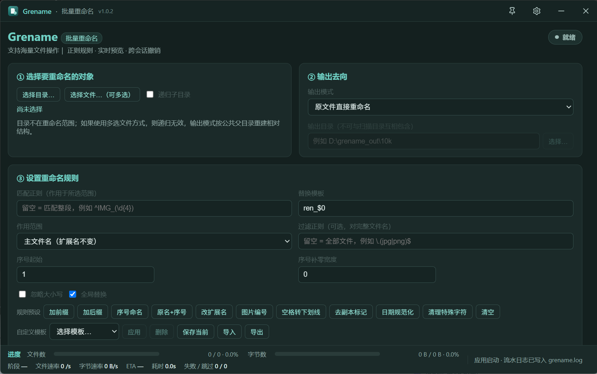
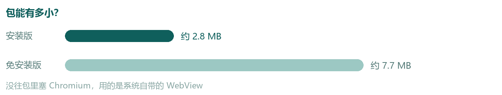
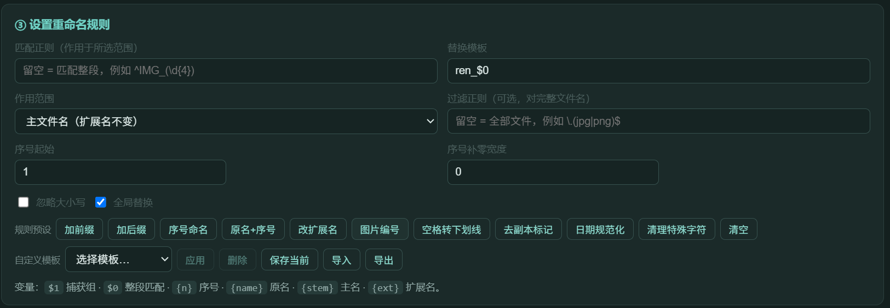
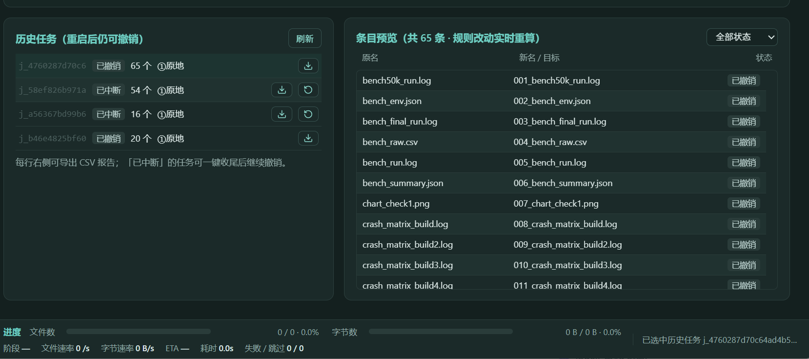
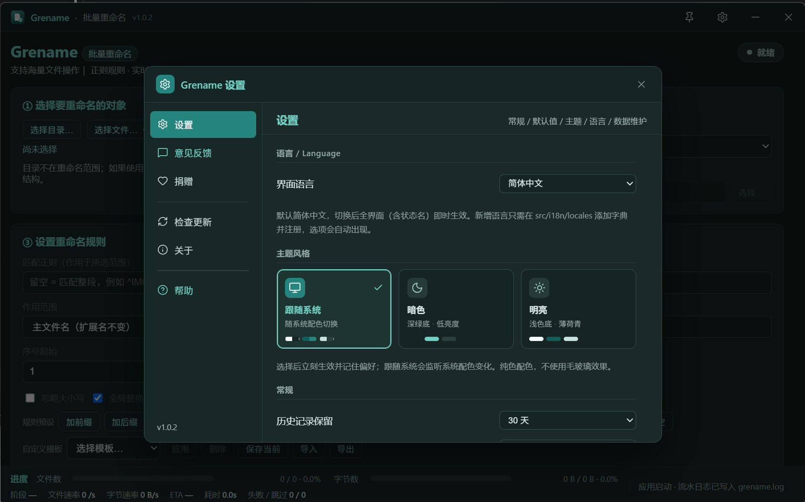
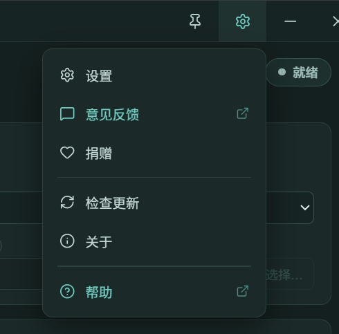

# Grename

**Rename a pile of messy filenames into exactly what you want.**

[](https://gr.graent.cn/grename)


Grename is a small, free desktop tool for **batch renaming files** with regular expressions. Pick a folder, write a rule (or just click a preset), preview every change, and only then apply it. Made a mess? Undo it — even after restarting the app.

It runs entirely on your machine. No account, no sign-up, no cloud upload.



## Why another renamer?

Because the usual options were either too clunky or too scary:

- Renaming by hand hurts when there are hundreds of files.
- A one-off script works, but a typo can wreck your filenames — and you have to dig it up from your chat history next time.
- Most tools make you commit before you can see what will actually happen.

Grename does four things differently:

1. **Preview is mandatory.** You cannot skip it. Every old name, new name and conflict is listed before anything changes.
2. **Undo survives restarts.** History is stored in a local SQLite database. Close the app, come back tomorrow, undo still works — after re-checking that the files haven't been touched.
3. **Presets for the regex-averse.** Most everyday jobs are one click away.
4. **It stays small.** No bundled browser, no telemetry, no background updater.

The whole flow is short:


## Features

- Regex matching with replacement templates — use `$0`, `$1`, `$2` for capture groups
- Presets for common jobs: add prefix/suffix, number files, change extension, strip copy tags, normalize dates, clean special characters, and more
- Sequence numbering with configurable start value and zero-padding width
- A **filter regex** to narrow down which files a rule applies to
- Save your own rules as reusable templates, export/import them as JSON (absolute paths are never stored)
- Two output modes: **rename in place** or **copy to another folder** while keeping the original directory structure
- Live preview that recalculates as you type
- Streaming progress with file counts, bytes, speed and ETA; large copies advance **by bytes**, not one jump per file
- Pause / resume during execution
- Cross-session undo with conflict re-checking and crash recovery
- Chinese and English UI, light/dark/system themes
- Runs offline

> Directories are never renamed. If you point the output folder inside the scan root, Grename refuses — no infinite recursion.

## Download

Grab the latest Windows build from the [project page](https://gr.graent.cn/grename):

| Build | What it is |
|---|---|
| `Grename-1.0.2-setup.exe` | NSIS installer — double-click and follow the wizard |
| `Grename-1.0.2-portable.exe` | Standalone exe — just run it, nothing is installed |

Pre-built binaries are currently published for **Windows** only. The codebase targets Windows, macOS and Linux, but macOS/Linux builds are not shipped yet — build them from source if needed.

No code-signing certificate is used, so Windows may show a SmartScreen warning on first run. That's expected.

Both are small because Grename uses Tauri and the system WebView instead of shipping a whole Chromium:



## Getting started

### 1. Pick your files

Choose individual files or a folder. There's an option to scan recursively. Directories themselves are never renamed.

### 2. Write a rule



You don't have to know regex. Click a preset under **Rule presets** and the fields fill themselves in. Then tweak as needed:

| Preset | What it does | Example |
|---|---|---|
| Add prefix | Prepends text | `report.pdf` → `ren_report.pdf` |
| Add suffix | Appends text | `report.pdf` → `report_done.pdf` |
| Numbered names | Four-digit sequence | `file_0001.jpg` |
| Name + number | Keeps the name, adds a number | `001_photo.jpg` |
| Change extension | Only the extension changes | `pic.jpeg` → `pic.jpg` |
| Number photos | Images only, four-digit sequence | `IMG_0001.png` |
| Spaces to `_` | Replaces whitespace | `my photo.png` → `my_photo.png` |
| Remove copy tag | Drops ` (1)`-style suffixes | `contract (2).pdf` → `contract.pdf` |
| Normalize dates | Unifies `.` / `_` dates to `-` | `2024.11.03.pdf` → `2024-11-03.pdf` |
| Strip specials | Replaces odd characters with `_` | `img#1@final.png` → `img_1_final.png` |

If you *do* like regex, here's a real example. Turn `IMG_20241103_142357.jpg` into `photo_20241103_142357.jpg`:

```text
Pattern:     ^IMG_(\d{8})_(\d{6})$
Replacement: photo_$1_$2
```

`(\d{8})` captures the eight-digit date as group 1, `(\d{6})` captures the six-digit time as group 2, and `$1` / `$2` paste them back. Scope is set to **file name only**, so the extension is untouched and you don't write `.jpg` in the rule.

Useful symbols: `^` start of name, `$` end of name, `\d` a digit (`\d{4}` = four digits), `( )` capture a group, `.*` any text, `[abc]` any one of those characters.

The filter regex runs against the full filename — e.g. `\.(jpg|png)$` to process images only.

### 3. Preview



This step can't be skipped. The list shows the before name, the after name and any conflicts. Change a rule and the list recalculates immediately.

### 4. Execute

Progress is pushed to the UI every 80 ms with file count, bytes, speed and ETA. You can pause and resume. If the process is killed mid-run, temporary files are cleaned up on the next launch.

Rename operations that would otherwise collide — `a → b` while `b → c`, swaps, or case-only changes on case-insensitive filesystems — are handled with a two-phase temporary-name scheme.

### 5. Undo, if you need it

History lives on disk. Undo re-checks that each file still exists and hasn't been replaced before restoring names, so it won't silently overwrite anything you changed in the meantime.

## Performance

Measured on one Windows machine with the real product pipeline (not a simulated benchmark), 1k → 100k empty files:


| Files | Scan (in place) | Execute (in place) | Execute (copy to dir) | Peak RSS | Progress p95 |
|---:|---:|---:|---:|---:|---:|
| 1,000 | 1,254 /s | 113 /s | 61 /s | 19.8 MB | 80.8 ms |
| 5,000 | 1,656 /s | 228 /s | 53 /s | 23.9 MB | 80.8 ms |
| 10,000 | 990 /s | 130 /s | 70 /s | 27.8 MB | 80.9 ms |
| 50,000 | 1,665 /s | 121 /s | 92 /s | 59.7 MB | 80.8 ms |
| 100,000 | 1,038 /s | 299 /s | 56 /s | 102.7 MB | 80.8 ms |

A separate large-file test used a fixed 256 MiB total per run:

| Layout | Byte throughput | Time |
|---|---:|---:|
| 32 × 8 MiB | 603.71 MiB/s | 0.42 s |
| 64 × 4 MiB | 152.04 MiB/s | 1.68 s |
| 128 × 2 MiB | 98.40 MiB/s | 2.60 s |
| 256 × 1 MiB | 47.40 MiB/s | 5.40 s |
| 64 × 4 MiB (fingerprint on) | 72.23 MiB/s | 3.54 s |

These are single-machine numbers, not promises. The point is that throughput stays flat as the file count grows — memory stays around 100 MB even at 100k files, and the UI keeps updating instead of freezing.

## Settings



- Language: Chinese / English
- Theme: system / light / dark
- History retention: 7 days, 30 days (default), 90 days or forever — this also sets the undo window
- Optional content-fingerprint verification before undo (off by default: it costs an extra disk read)
- Defaults for recursion, output mode and filter rule
- Progress refresh interval



## Free, updates, donations

**Grename is free.** No license key, no account, works offline. Only update checks, donations and feedback touch the network.

**Updates** are manual. *Settings → Check for updates* asks the server for the latest version and shows a dialog with the version, release notes and a download link. Nothing is downloaded or installed without you clicking.

**Donations** are entirely optional — if the tool saved you time, you can buy the author a coffee via WeChat or Alipay in *Settings → Donate*. The QR codes are verified with a local SHA-256 hash before display, so they can't be swapped. Donating never unlocks or changes any feature.

**Help and feedback now live on the forum.** The in-app *Help* and *Feedback* entries open the relevant forum sections instead of a built-in form.

## Links

- Website: <https://gr.graent.cn/grename>
- Help (forum): <https://q.graent.cn/forum.php?mod=forumdisplay&fid=7>
- Feedback (forum): <https://q.graent.cn/forum.php?gid=3>

## Build from source

You'll need Node.js 20.19+ (or 22.12+), Rust and the [Tauri 2 prerequisites](https://v2.tauri.app/start/prerequisites/) for your platform.

```bash
cd code
npm install
npm run dev          # Vite dev server
npm run tauri dev    # full desktop app
```

Frontend type-check and build:

```bash
npm run build        # runs vue-tsc --noEmit, then vite build
```

Desktop release build (installer + standalone exe on Windows):

```bash
npx tauri build                     # all configured bundles
npx tauri build --bundles nsis      # NSIS installer only
```

Built artifacts land under `src-tauri/target/release/`.

### Tech stack

| Layer | Technology |
|---|---|
| Desktop shell | Tauri 2 |
| Backend | Rust |
| Database | SQLite (tasks and undo history) |
| Frontend | Vue 3 + TypeScript + Vite |

## Support

If it helps you, you can buy the author a milk tea~

| WeChat Pay | Alipay |
|:---:|:---:|
|  |  |

## License

See the project page for licensing details.
