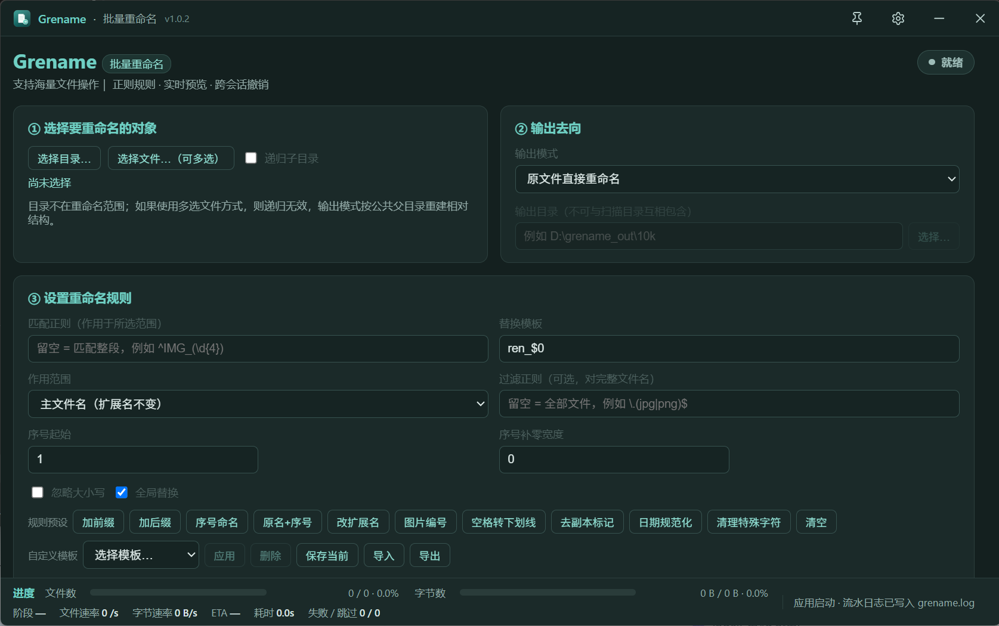
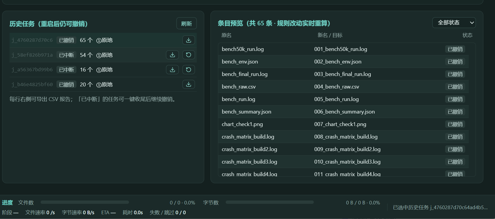
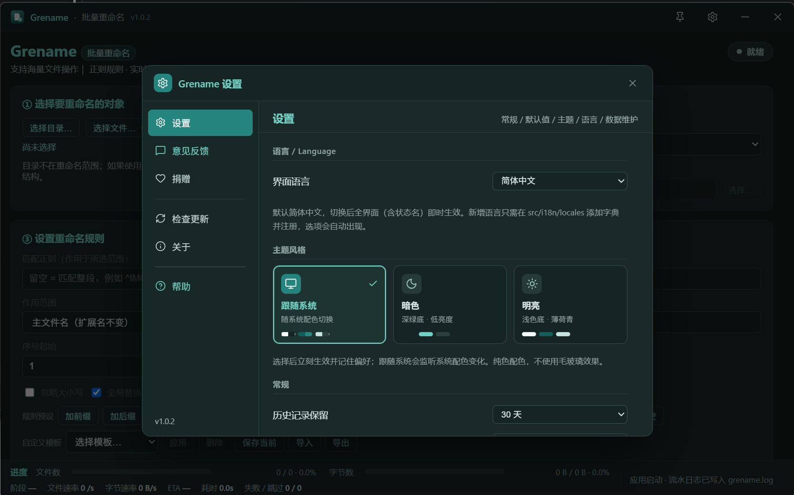
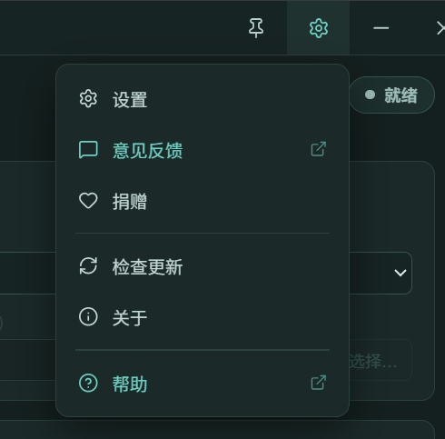

# Grename

**把一堆乱文件名，收拾成你想要的样子。**

[](https://gr.graent.cn/grename)


Grename 是一个免费的小型桌面工具，用正则表达式**批量重命名文件**。选一个文件夹，写一条规则（或者直接点预设），先预览每一处改动，确认没问题再执行。改错了也不慌，哪怕重启过软件，照样能撤销。

它完全在你本机运行。没有账号，不用注册，也不上传文件。



## 为什么又做了一个改名工具？

因为现有的选择要么太难用，要么太吓人：

- 文件一多，手动改名手就废了；
- 临时写个脚本能跑，但一个手滑就能把文件名改坏，下次还得翻聊天记录找脚本；
- 大多数工具让你先执行，执行完才知道改成什么样。

Grename 有四点不一样：

1. **预览是强制的。** 不能跳过。执行之前，每一个原名、新名和冲突都列得清清楚楚。
2. **撤销能跨会话。** 历史记录存在本地 SQLite 里。关掉软件，第二天再打开，撤销依然有效——前提是先复查过文件没被你动过。
3. **不会正则也有预设。** 日常需求基本点一下就搞定。
4. **体积很小。** 不塞浏览器、不上报数据、没有后台偷偷更新。

整个流程很短：


## 功能

- 正则匹配 + 替换模板，支持 `$0`、`$1`、`$2` 捕获组
- 常用需求都有预设：加前缀/后缀、序号命名、改扩展名、去副本标记、日期规范化、清理特殊字符等
- 序号可设置起始值和补零位数
- 用**过滤正则**限定规则作用到哪些文件
- 规则可存成模板，导出/导入 JSON（绝不保存绝对路径）
- 两种输出去向：**原地改名**，或者**复制到另一个目录**并保留原有目录结构
- 实时预览，改规则立刻重算
- 流式进度，含文件数、字节数、速率和 ETA；大文件复制**按字节推进**，不是完成一个文件才跳一次
- 执行中可暂停 / 恢复
- 跨会话撤销，带冲突复查和崩溃恢复
- 中英文界面，明亮/暗色/跟随系统三种主题
- 离线可用

> 目录本身不会被改名。如果输出目录设在扫描根目录里面，Grename 会直接拒绝——不会自己套自己。

## 下载

去[项目页面](https://gr.graent.cn/grename)拿最新的 Windows 版本：

| 版本 | 说明 |
|---|---|
| `Grename-1.0.2-setup.exe` | NSIS 安装包——双击跟着向导走 |
| `Grename-1.0.2-portable.exe` | 免安装版——直接运行，不写安装目录 |

目前**只提供 Windows 预编译包**。代码本身面向 Windows / macOS / Linux，但另两个平台尚未发布构建版，也没做过真机验证；需要的话可以从源码自己编译。

没有使用代码签名证书，所以 Windows 首次运行可能弹 SmartScreen 提示，这是正常的。

之所以这么小，是因为 Grename 用 Tauri + 系统自带的 WebView，没有把整个 Chromium 打进包里：


## 上手使用

### 1. 选文件

可以选单个文件，也可以选文件夹，有递归扫描选项。目录本身不会被改名。

### 2. 写规则


不用懂正则。点「规则预设」里的按钮，字段就自动填好了，之后想微调再改：

| 预设 | 作用 | 举例 |
|---|---|---|
| 加前缀 | 在文件名前加字 | `report.pdf` → `ren_report.pdf` |
| 加后缀 | 在文件名后加字 | `report.pdf` → `report_done.pdf` |
| 序号命名 | 四位序号 | `file_0001.jpg` |
| 原名+序号 | 保留原名，前面加序号 | `001_photo.jpg` |
| 改扩展名 | 只改后缀名 | `pic.jpeg` → `pic.jpg` |
| 图片编号 | 只处理图片，四位序号 | `IMG_0001.png` |
| 空格转下划线 | 空格换成 `_` | `my photo.png` → `my_photo.png` |
| 去副本标记 | 去掉 ` (1)` 这类尾巴 | `contract (2).pdf` → `contract.pdf` |
| 日期规范化 | 把 `.` `_` 分隔的日期统一成 `-` | `2024.11.03.pdf` → `2024-11-03.pdf` |
| 清理特殊字符 | 奇怪符号换成 `_` | `img#1@final.png` → `img_1_final.png` |

如果你*就是*喜欢写正则，看个真实例子。把 `IMG_20241103_142357.jpg` 改成 `photo_20241103_142357.jpg`：

```text
匹配正则：^IMG_(\d{8})_(\d{6})$
替换模板：photo_$1_$2
```

`(\d{8})` 把八位日期记成第 1 段，`(\d{6})` 把六位时间记成第 2 段，`$1`、`$2` 再把它们填回去。作用范围选的是「主文件名」，扩展名不动，所以规则里不用写 `.jpg`。

常用符号：`^` 开头，`$` 结尾，`\d` 一个数字（`\d{4}` 是四位），`( )` 捕获分组，`.*` 任意内容，`[abc]` 括号里任意一个字符。

过滤正则针对完整文件名再筛一遍，比如 `\.(jpg|png)$` 表示只处理图片。

### 3. 预览



这步不能跳过。列表里能看到原名、新名和冲突。规则一改，列表立刻重算。

### 4. 执行

进度每 80ms 推给界面一次，含文件数、字节数、速率和 ETA，可以暂停和恢复。中途强杀进程，下次启动会清理临时文件。

像 `a → b` 同时 `b → c`、两个文件互换，或者在大小写不敏感的系统上只改大小写——这类会撞车的改名，用两阶段临时名来处理。

### 5. 撤销（如果需要）

历史记录存在磁盘上。撤销前会复查每个文件是否还在、有没有被替换过，所以不会一声不吭覆盖掉你后来改过的东西。

## 性能

在同一台 Windows 机器上用产品真实链路测的（不是另写的模拟脚本），1k → 100k 空文件：


| 文件数 | 扫描（原地） | 执行（原地） | 执行（复制到目录） | 内存峰值 | 进度 p95 |
|---:|---:|---:|---:|---:|---:|
| 1,000 | 1,254 /s | 113 /s | 61 /s | 19.8 MB | 80.8 ms |
| 5,000 | 1,656 /s | 228 /s | 53 /s | 23.9 MB | 80.8 ms |
| 10,000 | 990 /s | 130 /s | 70 /s | 27.8 MB | 80.9 ms |
| 50,000 | 1,665 /s | 121 /s | 92 /s | 59.7 MB | 80.8 ms |
| 100,000 | 1,038 /s | 299 /s | 56 /s | 102.7 MB | 80.8 ms |

另外单独做了一组大文件测试，每组固定 256 MiB 总量：

| 切分方式 | 字节吞吐 | 耗时 |
|---|---:|---:|
| 32 × 8 MiB | 603.71 MiB/s | 0.42 s |
| 64 × 4 MiB | 152.04 MiB/s | 1.68 s |
| 128 × 2 MiB | 98.40 MiB/s | 2.60 s |
| 256 × 1 MiB | 47.40 MiB/s | 5.40 s |
| 64 × 4 MiB（开指纹校验） | 72.23 MiB/s | 3.54 s |

这些只是单机实测，不是承诺。想说明的是：文件数涨上去以后吞吐不会塌，10 万档内存也就一百 MB 出头，界面不会卡成幻灯片。

## 设置



- 语言：中文 / 英文
- 主题：跟随系统 / 明亮 / 暗色
- 历史保留时长：7 天、30 天（默认）、90 天或永久；这个时长同时决定撤销有效期
- 撤销前是否做内容指纹校验（默认关，因为会多读一次盘）
- 默认递归、默认输出去向、默认过滤规则
- 进度刷新间隔



## 免费、更新、捐助

**软件免费。** 没有注册码，没有账号，离线也能改名。只有检查更新、捐助和反馈会走网络。

**更新是手动的。** 设置里点「检查更新」，会问服务器当前最新版，弹窗告诉你版本、更新说明和下载链接。不点就不会下载、不会安装。

**捐助纯属自愿。** 觉得它省了你时间，可以在「设置 → 捐赠」里用微信或支付宝请作者喝杯奶茶。二维码显示前会做本地 SHA-256 校验，防止被替换。捐不捐都不影响任何功能。

**帮助和反馈搬到论坛了。** 软件里的「帮助」和「意见反馈」会打开论坛对应板块，不再在客户端里塞表单。

## 链接

- 官网：<https://gr.graent.cn/grename>
- 帮助（论坛）：<https://q.graent.cn/forum.php?mod=forumdisplay&fid=7>
- 意见反馈（论坛）：<https://q.graent.cn/forum.php?gid=3>

## 从源码构建

需要 Node.js 20.19+（或 22.12+）、Rust，以及对应平台的 [Tauri 2 前置依赖](https://v2.tauri.app/start/prerequisites/)。

```bash
cd code
npm install
npm run dev          # Vite 开发服务器
npm run tauri dev    # 完整桌面应用
```

前端类型检查和构建：

```bash
npm run build        # 先 vue-tsc --noEmit，再 vite build
```

桌面版 release 构建（Windows 上会产出安装包和免安装版）：

```bash
npx tauri build                     # 配置的所有 bundle
npx tauri build --bundles nsis      # 只打 NSIS 安装包
```

产物在 `src-tauri/target/release/` 下。

### 技术栈

| 层次 | 技术 |
|---|---|
| 桌面壳 | Tauri 2 |
| 后端 | Rust |
| 数据库 | SQLite（任务与撤销记录） |
| 前端 | Vue 3 + TypeScript + Vite |

## 捐助

如果对你有帮助，可以请作者喝杯奶茶~

| 微信 | 支付宝 |
|:---:|:---:|
|  |  |

## 许可

详见项目页面。
